<!-- Real-time animated contribution graph -->
<h2>Contributions</h2>

  

<!-- Dual side-by-side terminal windows: Animated ASCII portrait + Streak & Bar Chart stats -->
<table>
  <tr>
    <td width="50%" valign="top">
      
    </td>
    <td width="50%" valign="top">
      
    </td>
  </tr>
</table>

  

<!-- Terminal Developer Info Card -->
<h2>About Me</h2>

  

<!-- Featured Projects -->
<table width="860">
  <tr>
    <td width="50%" valign="top">
      <h4><a href="https://github.com/iblamelessly/Ecommerce-big-Data-Analysis">📦 Ecommerce-big-Data-Analysis</a></h4>
      
Data engineering & analytics pipeline exploring consumer behaviors, sales trends, and high-volume transaction datasets using Python.

    </td>
    <td width="50%" valign="top">
      <h4><a href="https://github.com/iblamelessly/NGO-Data-Analysis">🤝 NGO-Data-Analysis</a></h4>
      
Exploratory data analysis and socioeconomic metrics evaluation tailored for non-profit operational insights.

    </td>
  </tr>
  <tr>
    <td width="50%" valign="top">
      <h4><a href="https://github.com/iblamelessly/Titanic-Excel-Analysis">📊 Titanic-Excel-Analysis</a></h4>
      
Structured exploratory data analysis, feature engineering, and statistical survival insights modeled in Excel & Python.

    </td>
    <td width="50%" valign="top">
      <h4>📫 Connect with me</h4>
      

        
        
      

    </td>
  </tr>
</table>

